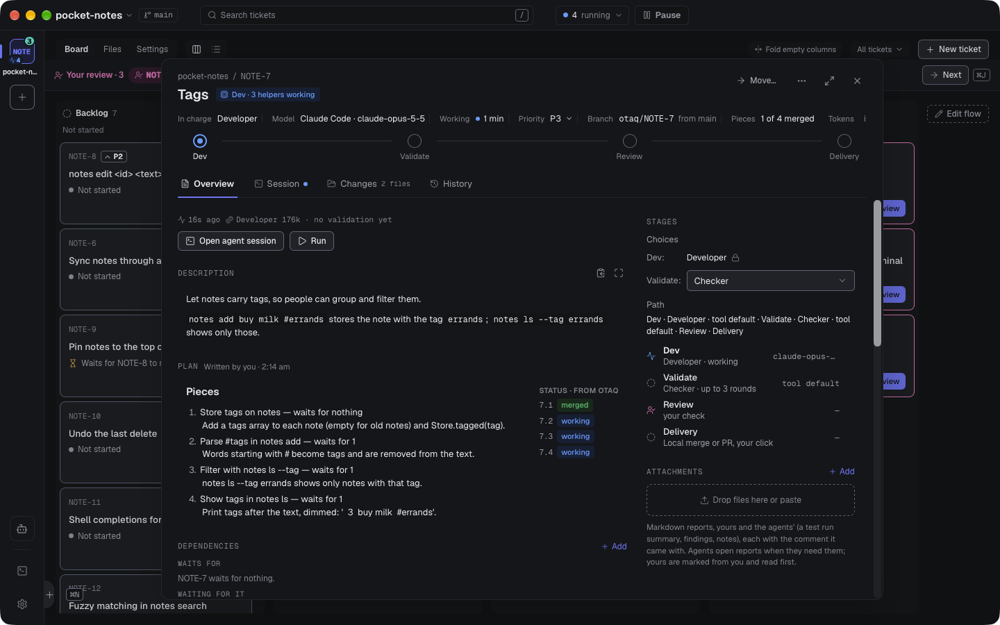

# How Otaq works

[← README](../README.md)

## Why Otaq

Running one coding agent is easy. Running eight at once is not: they edit the same checkout, you lose track of
which one is waiting on a question, and reviewing the result means digging through branches. Otaq turns that into a
board.

- **The right agent for each ticket.** Use Claude Code, Codex, GitHub Copilot and OpenCode on the same board, at the
  same time. A tricky bug can go to Opus in Claude Code while a docs fix goes to a small, cheap model, and the work can
  be checked by a model from another company. See [Agents: any tool, any model](#agents-any-tool-any-model).
- **One ticket, one agent, one worktree.** Every ticket gets its own git worktree and branch, so parallel agents never
  step on each other or on your own checkout.
- **Dependencies, so work happens in order.** Ticket B can wait for ticket A. B starts only once A is merged, so it
  always builds on finished work.
- **The real terminal of each tool.** Agents run the actual `claude`, `codex`, `copilot` or `opencode` program, not
  an imitation. You can watch any agent and type into its session at any moment.
- **You only look when it matters.** Cards that need you (a question, a permission prompt, an agent that stopped)
  turn turquoise and show in the Needs you strip above the board; ⌘J takes you to the next one, in any project.
- **A second pair of eyes.** When an agent says it's done, a separate read-only *checker* agent checks the change
  against the ticket. Failures go straight back to the agent; only passing work reaches you.
- **Proven in the running app.** Where a criterion shows in what the app does, the agent starts the ticket's own copy
  of your app, drives it and keeps the evidence, and the checker does the same before it fails a ticket. What they
  drove is written down in a verification guide in your repository (`docs/verify/`), so the next agent knows how.
- **Review like a pull request.** What the agent did, what the checker found, the diff against the ticket's starting
  point and line comments; then Send back, or **Approve & merge into main** (a squash merge) or **Approve & open PR**
  on GitHub or Azure DevOps.
- **Agents keep running when the window is closed.** A background service owns every session; reopen the app and
  everything is where you left it.
- **Your setup, untouched.** Otaq uses each tool's own settings, sign-in and permission mode, your `git`, `gh` and
  `az` logins, and never adds files to your repository. What it does record in a tool's own config is listed under
  each tool in Settings → Agents: mainly that you trust the folders you add as projects, so agents don't stop on a trust
  screen.

## How it works

The board's columns are the project's flow. The default one, Otaq default:

```
Backlog ──► Dev ──────────────────────► Validate ───────► Review ──────────────► Done
  Start     waits at the top for what     a checker         you read what           merged into main,
            it waits for and a free       checks the work   changed, then Approve   or a PR opened:
            agent; then the agent works                     or Send back            the flow's delivery
```

1. **Write tickets.** Type in the box at the bottom of the board ("New ticket, or ask Noyan…", ⌘N): the first line is
   the title and the rest the description, and ↵ creates the ticket in Backlog. **More options…** opens the full
   form: Title, a Markdown Description (acceptance criteria are just text in it), Priority (P1 Urgent, P2 High, P3
   Normal, P4 Low), **Waits for** (the tickets that must merge first), Attachments, the agent for each stage and the
   base branch.
2. **Start a ticket**: its **Start** button, ⌘D or a drag into Dev; ⌘↵ in the box and **Create & start** in the form
   create and start it in one step. It goes into Dev, waiting at the top of the column while it says why ("Waits for
   SHOP-12 to merge", "Waits for a free agent · 2nd in line"); nothing is spent until then. Then Otaq creates a
   worktree from your base branch, runs your setup command (for example `pnpm install`), and starts the Dev stage's
   agent: the one the flow names, or the one you picked for this ticket.
3. **The agent works.** It reads its ticket through the `otaq` command, plans, implements and commits. If it hits a
   question it can't answer from the code or docs, it asks you (the card turns turquoise, with answer options). Smaller
   product choices it makes on its own and records on the ticket, so you can see them in review. It proves each
   criterion before it submits: with the project's tests, or by starting the ticket's [Run](#run-and-terminal) and
   driving the app, or, when nothing else reaches it, with a manual check it hands you with exact steps.
4. **The checker checks.** When the agent submits, Validate's checker, a fresh read-only agent, compares the change
   with the ticket and the checks you asked for. A suspected breakage fails the ticket only once a run shows it. If
   something is missing, the findings go back to the agent (up to 3 rounds by default).
5. **You review.** The ticket arrives in Review and opens on Overview: what the agent did, what the checker found and
   every decision the agent recorded; the Changes tab has the diff. Comment on lines and **Send back**, or approve.
6. **Deliver.** How work leaves the flow is the flow's own setting, shown on Done ("Merge or PR · on Approve").
   **Approve & merge into main** squashes the branch into your base branch (rebasing first if the base moved).
   **Approve & open PR** pushes and opens a pull request, with a dialog where you edit the branch name, title and
   description first; the ticket then waits in Review as "PR open" until you **Mark merged** (Otaq doesn't watch the
   PR). Once it's merged, tickets that were waiting for it start on their own.

### Agents: any tool, any model

Otaq runs four agent tools: **Claude Code**, **OpenAI Codex CLI**, **GitHub Copilot CLI** and **OpenCode**. Copilot
and OpenCode can run models from several companies, so they bring Gemini and others too. Connect any of them under
Tools in Settings → Agents (the gear at the foot of the rail; Otaq finds what's installed and signed in; it never handles your passwords or API keys).

In Settings → Agents you keep a short list of **named agents**. Each one is a tool, a model and a note on what it's
for:

| Named agent | Tool · model | Use for |
|---|---|---|
| Strong | Claude Code · `opus` | complex features and tricky bugs |
| Standard | Codex · a GPT model | normal tickets |
| Light | Claude Code · `haiku` | typos, docs, small config |
| Verifier | Copilot · a Gemini model | checking |

(These are examples you'd make yourself. A fresh install starts with one entry per connected tool, using that tool's
default model.) The model picker reads each tool's own model list, with "always the newest" choices such as `opus`, so
a new model needs no Otaq update.

- **One agent per stage.** Each stage of your flow names the agent that runs it: Dev on Strong, Validate on
  Verifier. A check has one agent too. Two checks are two stages, one after the other, each with its own agent,
  skill and rounds. A ticket's helpers run on the same agent as the one in charge. Agents have no roles: Noyan uses
  the one agent set in Settings → Agents ("Noyan uses"), and a new conversation can pick another before you send.
- **Stage choices are yours.** For any stage of a ticket that hasn't started you can pick any agent whose tool has
  the stage's skill (a stage running one of Otaq's own skills takes every agent): `SHOP-18` can be written by Opus in
  Claude Code and checked by a GPT model in Codex, while `SHOP-19` goes to Light. You can also skip the stages the
  flow marks skippable; a skippable check of yours offers "required" (it happens) and "skip". Noyan passes on only
  the choices you name ("2: Dev: Light"); otherwise every ticket runs every stage of its flow with that stage's own
  agent. A ticket's own agent never picks or skips: only you do. A card waiting for its tool offers **Change
  agent…**, the same choice for the waiting stage.
- **Nothing is skipped on its own.** A stage runs unless you skip it for that ticket, even when every stage before
  it was skipped. **Skip this check** shows only on checks the flow marks skippable; on other checks you wait, pick
  another agent, or send the ticket back. A check that fails all its rounds can always be sent on to the next stage
  (**Send it on**), with the checker's last report, so you judge it at Review. A skipped or moved-past check doesn't change the
  Delivery: it does what the flow says, so an automatic one still delivers on its own, and its card says
  "Delivered without all checks".
- **Limits per tool.** When one tool hits its usage limit, is logged out, not installed, hidden or needs an update,
  only its agents wait; the rest keep going, and the banner says so. An agent whose model its tool no longer lists
  waits the same way. The card says why and offers **Open agent…** and **Change agent…**. Otaq never moves their
  work to another tool. A running conversation never changes tools.
- **Tokens per tool.** Tickets show the tokens each tool reports. The header's **Running** button (⇧⌘U, shown while
  agents run) opens what each tool has used today and what's left in each of its limit windows ("48% left"), and the
  usage chip beside it warns when little is left. Otaq shows no dollar estimates.

Asking you questions, recording decisions and submitting for review all go through the `otaq` command, so they work
the same in every tool. Cards show Working, Needs you and Idle from each tool's own hooks or plugin events.

**A tool that stops on an error** doesn't leave its card on Working. A usage or quota limit (Claude Code's plan
limit, a Codex or Copilot limit, an OpenCode provider's quota or rate limit) is that tool's limit: its agents wait
for the reset, with the retry time the error gives. Any other error (a refused key, a server error the tool gave up
on) stops the card on Idle with the tool's own message, "Stopped on an error: …". A message waiting for the agent
stays with the card until its session continues, or until you click **Deliver now**.

### Skills

**Your skills stay where they are.** Each agent tool finds them the way it always does: your personal skills
(`~/.claude/skills` and the like) and the project skills committed to your repository, which git puts in every
worktree. Otaq doesn't copy, import or rename them, and writes no skill folder into a worktree or your checkout. A
project skill you haven't committed reaches a worktree only in Claude Code, which falls back to your checkout's
`.claude/skills`.

**Otaq's own skills come with its plugin**, the same plugin that carries its hooks, so every session has all of them
from its start (they're listed under [the `otaq` command](otaq-command.md)). A session names a skill in its tool's
form:

| Tool | Otaq's own skill | Your own skill |
|---|---|---|
| Claude Code | `/otaq:<name>` | `/<name>` |
| Copilot | `/otaq:<name>` | `/<name>` |
| Codex | `$otaq:<name>` | `$<name>` |
| OpenCode | `<name>` | `<name>` |

OpenCode has no typed command for a skill: its model loads a skill with its skill tool when it decides to. So a
message Otaq types into an OpenCode session names the skill as an instruction, "Load the skill `<name>` with your
skill tool and follow it. If you don't have a skill with that name, say so and stop.", followed by the usual text.

**A flow stage names the skill it runs.** Agents have no skill list; the stage's Skill field is the one place a skill
is picked. **Pick a skill…** lists the skills Otaq finds in your tools' folders and in the project, plus Otaq's own,
and you can also type a name. A stage that names no skill runs Otaq's own skill for it (`validate` on Validate,
`open-pr` for the flow's delivery, which names its own with `skill:` under `delivery:`). A stage that names a skill you don't have still applies, with the warning
"You don't have the skill `<name>`". A stage can't name a tool's built-in command, such as Claude Code's
`/security-review`, as its skill unless you have a skill of that name: the flow is refused, so write a small skill
that runs the command and name that skill instead.

**A stage runs only on a tool that has its skill.** A stage due to start on a tool that doesn't have the skill it
names doesn't start: its card waits in Needs you with "Codex doesn't have the skill `$team-validate`", **Check
again** (Otaq looks for the skill again and starts the stage if it is found) and **Change agent…** (only agents
whose tool has the skill). A tool has a skill when it finds it in the ticket's worktree: in its own personal
folder, in the project's folders when the skill is committed, or, for Claude Code, in the checkout's
`.claude/skills`. To give another tool a skill, link it into that tool's folder or commit it to the project. The
same goes for a skill typed into a session that is already running: opening a PR from the Dev session, with a delivery
skill that session's tool doesn't have, types nothing and says why.

Otaq only reads these folders, never writes them. Your personal ones: `$CLAUDE_CONFIG_DIR/skills` (else
`~/.claude/skills`), `~/.agents/skills`, `$CODEX_HOME/skills` (else `~/.codex/skills`), `$COPILOT_HOME/skills`
(else `~/.copilot/skills`) and `$XDG_CONFIG_HOME/opencode/skills` (else `~/.config/opencode/skills`), each
variable followed as its tool follows it. The project's: `.claude/skills`, `.agents/skills`, `.github/skills` and
`.opencode/skills` in its checkout. Every folder in them holding a `SKILL.md` is a skill: its name is the front
matter's `name:`, else the folder's name. Links are followed, so a skill kept in your own repository and linked
into `~/.claude/skills` is found, and a skill linked into several folders is listed once.

**"Ask the agent to write it" saves into the project.** Noyan writes the new skill into the project's checkout:
`.agents/skills/<name>/` when the stage's agent runs on Codex, `.claude/skills/<name>/` otherwise. Otaq doesn't
commit it, and the field says "Saved in `<folder>` in this project. Commit it so agents get it in their worktrees."
A ticket's worktree is made from a commit, so commit the skill before tickets need it. Undo deletes the folder
while it's still uncommitted and holds only what Noyan wrote; otherwise it just clears the field.

### Bigger features: a Plan and helpers

A bigger feature is still **one ticket** that walks the flow, with one agent in charge at each stage. The ticket can
carry a Markdown **Plan**, written by a planning stage of your flow, by the Dev agent when it splits the work, or by
you, with one **Pieces** list:

```markdown
## Pieces
1. Wishlist API
2. Wishlist button — waits for 1
```

In the build stage, the agent in charge may start **helpers**: other agents, one per piece, each in its own worktree.
It reviews each helper's work, sends it back with a note or merges it into the ticket's branch, so the feature
reaches your base branch, or a pull request, as **one** change. Helpers are rows inside the card
(`40.1 merged · 40.2 working`). A helper's questions go to the agent in charge, which answers them or passes them on
to you with a note; its permission prompts come straight to you, and you answer in its terminal. The ticket takes one
slot, and Pause, Park and a restart treat it and its helpers as one.

When a ticket reaches the build stage without pieces, its Dev agent decides before it writes any code whether one
agent should build it or the work should be split into pieces. A piece fits one agent when it changes one behaviour,
in one area or layer, and needs only a handful of files read; when unsure, the agent splits. When the work turns out
bigger partway through, the agent commits what it has and writes a Plan for the rest, and a helper whose piece turns out too big hands back what it built with a suggested
split, which the agent in charge adds to the Plan. Helpers never start helpers of their own.

### Noyan and terminals

**Noyan** starts from the box for new work at the bottom of the board: type what you want and press ⇧↵ (Ask Noyan to
shape it), and it opens as a panel on the left, where a conversation starts on its named agent, investigates the codebase and writes Backlog tickets for you, including importing them from your team's tracker with
your own skills. It reads code but never edits it. Noyan's button sits at the foot of the rail (⌘L), with
**Terminal** (⌃`), which opens plain terminals in the project, and the gear for the app's Settings.

## A tour of the app

> The screenshots show a small demo project, `pocket-notes` (a notes app for the terminal), with real Claude Code
> agents working on it.

### The board


The window has a rail on the left with your projects and **+** to add one, and at its foot Noyan, Terminal and the
gear (Settings). The project's name in the header opens a switcher; beside the search field, **Running** and
**Pause** show while agents work. Under the header, **Board**, **Files** and **Settings** switch the project's view,
and two small buttons lay the Board out as columns or as a **List** of the same tickets.

The board has a column per stage of the project's flow, between the fixed Backlog and Done: by default Backlog, Dev,
Validate and Review, with Done folded into a link under the last column ("Done 2 →"). Above the tickets, the
**Needs you** strip lists the questions waiting for you and **Your review** the tickets ready for you; **Next** (⌘J)
opens the first one. **Pause** stops every agent of a project (or of all projects) at once until you resume. Cards
show status, priority, what they wait for ("Waits for NOTE-8 to merge"), check rounds, recorded decisions and
conflicts with the base branch. Hover a card to highlight its dependency chain. Turquoise means "needs you", magenta
means "your review". The box at the bottom, "New ticket, or ask Noyan…", is where new work starts, and **Edit flow**
at the end of the board turns the columns into the flow's editor in place.

### A live agent


Click a card to open the ticket as a sheet, with the tabs **Overview · Session · Changes · History**. Session holds the
agent's real session in its own tool, and you can type into it at any time; its switch also shows the check's session
(**Validate**), the ticket's **Run** and a **Terminal** in its worktree. Otaq never mixes its own messages into text
you've started typing. Here the agent has finished `NOTE-4` (colorize the output) and sums up the pull request
message it wrote while the ticket waits for review, with the one check left for you. From any terminal,
`otaq attach NOTE-4` opens the same session. **History** tells the ticket's story, newest first, under the filters
All · Questions · Checks · Sessions.

### Review


A ticket in Review opens on **Overview**: the checks only you can do, what the agent says it did, what the checker
found, and every decision it recorded (what it built, the other option, and why), then the ticket itself. The bar
under every tab names Approve by what it does, **Approve & merge into main** (or **Approve & open PR**), and the
button beside it holds the other ways to finish: open a PR instead, Merge into another ticket…, Done, nothing to
merge. **Change…** on a decision, or **Send back** with comments, returns the ticket to the agent. While the agent
works, the comment box has two buttons: **Comment** (the next stage reads it) and **Tell <agent> now** (the working
agent also gets it, once it's idle).


The **Changes** tab shows the diff against the commit where the ticket started (All changes, unified or split), with
the agent's summary and the checker's report above it, and every file of the worktree, with line comments.

### The Plan and helpers



A ticket's Overview shows its Plan, with who wrote it and its pieces in order (`2. Parse #tags in notes add — waits
for 1`). While the ticket is in the build stage, each piece shows its helper's status (`7.1 merged`, `7.2 working`),
the card says "Working · 3 helpers", and the Changes tab tags each change with the piece it came from. A helper
waiting on you shows in the Needs you strip as `NOTE-13 · 13.2 asks`; ⌘J opens its terminal.

### Run and Terminal

Every ticket gets its own ports, so several agents can run dev servers at once. **Run** starts the project's run
command in the ticket's worktree, with a log and an optional Open URL, and the card shows it (`Serving :4020`). A
project can have several **apps** (a monorepo's `web` and `api`): each has its own command and its own port per
ticket, gets its port as `$PORT` and finds the others at `$OTAQ_PORT_<NAME>` (`$OTAQ_PORT_API`), and Session's Run
shows one section per app.

A ticket has one Run, shared by you and its agents, and it says who started it ("Serving · started by Dev"). The
ticket's agent and its checker can start, restart, read and stop it with `otaq run`. An agent never stops a Run
you started: when your Run serves code from before its change, it restarts it on the same port, and it stays yours.
Otaq stops an agent's Run when that agent's stage ends. A project with no run command can get one from an agent
(`otaq run set`): it is saved only once it runs, never replaces one you set, and shows as "Set by Dev on SHOP-27"
with **Undo** in the project's Settings (Run).

**Terminal** is a plain terminal in the ticket's worktree.

### Themes

15 bundled themes. Settings → Appearance has **Match system** (the default: a light theme while macOS or Windows is
light and a dark one while it is dark, switching as the system does), **Light** and **Dark**, and picks the light and
the dark theme: Otaq Dark (the screenshots above) and Otaq Light,
Catppuccin (Latte, Frappé, Macchiato, Mocha), Tokyo Night, Dracula, Nord, Gruvbox Dark, Rosé Pine and Rosé Pine Dawn,
One Dark, Daylight (the board above) and Solarized Light.

