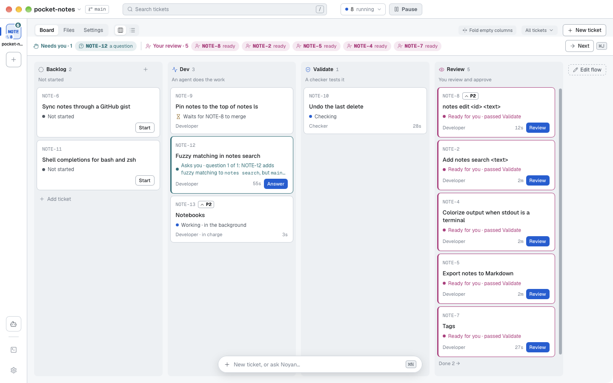
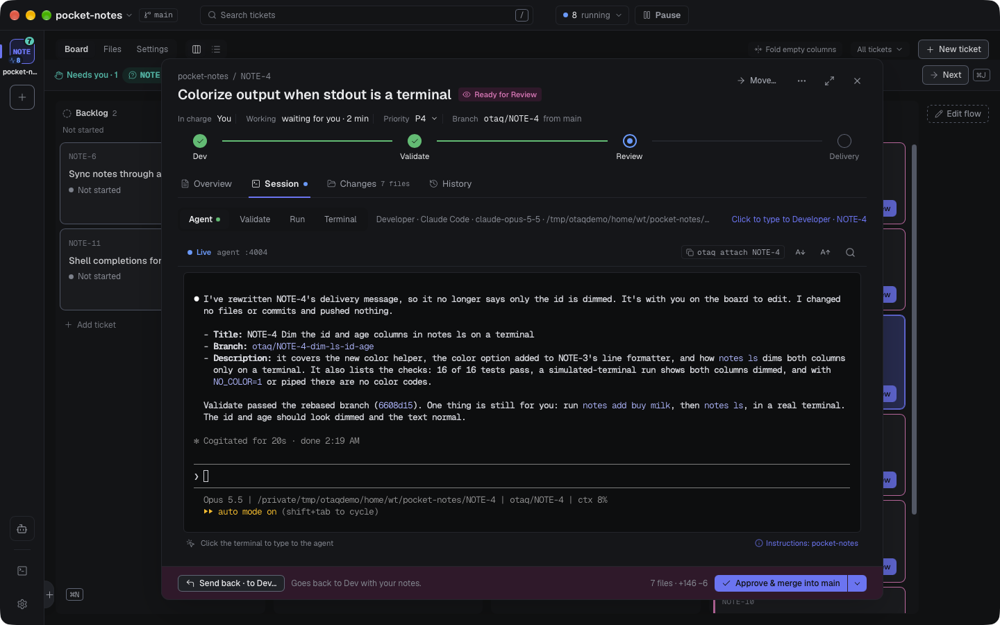
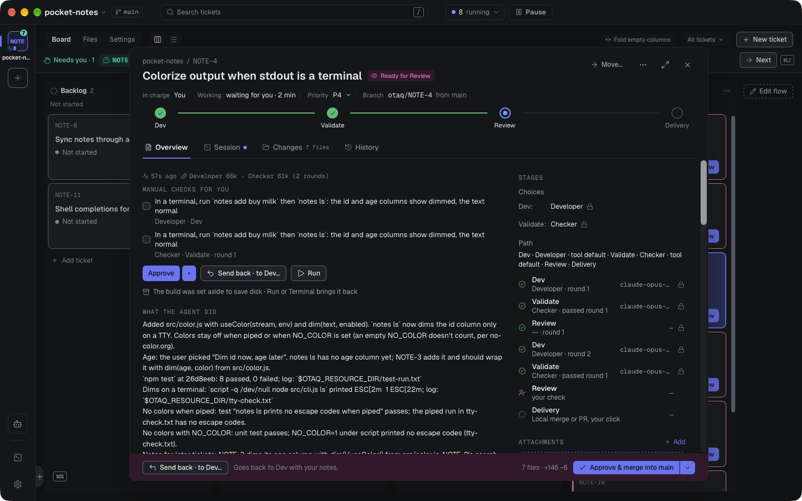
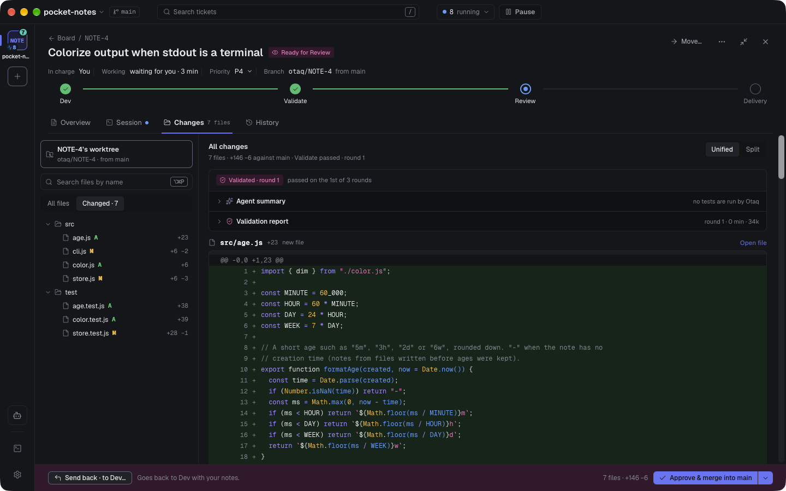

# How Otaq works

[← README](../README.md)

## Why Otaq

Running one coding agent is easy. Running eight at once is not: they edit the same checkout, you lose track of
which one is waiting on a question, and reviewing the result means digging through branches. Otaq turns that into a
board.

- **The right agent for each ticket.** Use Claude Code, Codex, GitHub Copilot and OpenCode on the same board, at the
  same time. A tricky bug can go to Opus in Claude Code while a docs fix goes to a small, cheap model, and the work can
  be checked by a model from another company. See [Agents: any tool, any model](#agents-any-tool-any-model).
- **One ticket, one agent, one worktree.** Every ticket gets its own git worktree and branch, so parallel agents never
  step on each other or on your own checkout.
- **Dependencies, so work happens in order.** Ticket B can wait for ticket A. B starts only once A is merged, so it
  always builds on finished work.
- **The real terminal of each tool.** Agents run the actual `claude`, `codex`, `copilot` or `opencode` program, not
  an imitation. You can watch any agent and type into its session at any moment.
- **You only look when it matters.** Cards that need you (a question, a permission prompt, an agent that stopped)
  turn turquoise and show in the Needs you strip above the board; ⌘J takes you to the next one, in any project.
- **A second pair of eyes.** When an agent says it's done, a separate read-only *validator* agent checks the change
  against the ticket. Failures go straight back to the agent; only passing work reaches you.
- **Proven in the running app.** Where a criterion shows in what the app does, the agent starts the ticket's own copy
  of your app, drives it and keeps the evidence, and the validator does the same before it fails a ticket. What they
  drove is written down in a verification guide in your repository (`docs/verify/`), so the next agent knows how.
- **Review like a pull request.** Diff against the ticket's starting point, line comments, Send back, then Approve with a
  local squash merge or a GitHub / Azure DevOps pull request.
- **Agents keep running when the window is closed.** A background service owns every session; reopen the app and
  everything is where you left it.
- **Your setup, untouched.** Otaq uses each tool's own settings, sign-in and permission mode, your `git`, `gh` and
  `az` logins, and never adds files to your repository. What it does record in a tool's own config is listed under
  Settings → Agent tools: mainly that you trust the folders you add as projects, so agents don't stop on a trust
  screen.

## How it works

```
Backlog ──► Ready for Dev ──► Dev ──────────────► Ready for Review ──► Approved ──► Done
            (waits for its     agent works,        you read the diff,   local merge
             dependencies      validator checks    comment, send back   or open a PR
             and a free slot)  the result          or approve
```

1. **Write tickets.** A title and a description in a rich Markdown editor. Acceptance criteria are just text in the
   description. Give a ticket a priority (Urgent, High, Normal, Low) and the tickets it depends on.
2. **Drag a ticket to Dev** (or Ready for Dev). If its dependencies are merged, Otaq creates a worktree from your base
   branch, runs your setup command (for example `pnpm install`), and starts the ticket's agent: the tool and model
   picked for it, or the project's default.
3. **The agent works.** It reads its ticket through the `otaq` command, plans, implements and commits. If it hits a
   question it can't answer from the code or docs, it asks you (the card turns turquoise, with answer options). Smaller
   product choices it makes on its own and records on the ticket, so you can see them in review. It proves each
   criterion before it submits: with the project's tests, or by starting the ticket's [Run](#run-and-shell) and
   driving the app, or, when nothing else reaches it, with a manual check it hands you with exact steps.
4. **The validator checks.** When the agent submits, a fresh read-only agent compares the change with the ticket and
   the checks you asked for. A suspected breakage fails the ticket only once a run shows it. If something is missing,
   the findings go back to the agent (up to 3 rounds by default).
5. **You review.** The ticket arrives in Ready for Review with its diff, the agent's summary, the validator's report and
   every decision the agent recorded. Comment on lines and **Send back**, or **Approve**.
6. **Merge.** *Local merge* squashes the branch into your base branch (rebasing first if the base moved). *Open PR*
   pushes and opens a pull request, with a dialog where you edit the branch name, title and description first.
   When it's merged, tickets that were waiting on it start on their own.

### Agents: any tool, any model

Otaq runs four agent tools: **Claude Code**, **OpenAI Codex CLI**, **GitHub Copilot CLI** and **OpenCode**. Copilot
and OpenCode can run models from several companies, so they bring Gemini and others too. Connect any of them in
Settings → Agent tools (Otaq finds what's installed and signed in; it never handles your passwords or API keys).

In Settings → Agents you keep a short list of **named agents**. Each one is a tool, a model and a note on what it's
for:

| Named agent | Tool · model | Use for |
|---|---|---|
| Strong | Claude Code · `opus` | complex features and tricky bugs |
| Standard | Codex · a GPT model | normal tickets |
| Light | Claude Code · `haiku` | typos, docs, small config |
| Verifier | Copilot · a Gemini model | validating |

(These are examples you'd make yourself. A fresh install starts with one entry per connected tool, using that tool's
default model.) The model picker reads each tool's own model list, with "always the newest" choices such as `opus`, so
a new model needs no Otaq update.

- **Pick per ticket.** Every ticket has a **Developer** and a **Validator** row. `SHOP-18` can be written by Opus in
  Claude Code and checked by a GPT model in Codex, while `SHOP-19` goes to Light. A ticket's helpers run on the same
  agent as the one in charge.
- **Defaults per role, overridable per project.** Choose which named agent writes code, validates and answers as
  Noyan; a project can change any of the three.
- **Stage choices are yours.** Noyan passes on only the choices you name ("2: Dev: Light"); otherwise every ticket
  runs every stage of its flow with that stage's own agent. A ticket's agent may pick another agent for a later stage
  of its ticket, with a reason (a stronger Validator when the change turned out risky), but it never skips one: only
  you skip a stage. Your own choice always wins.
- **Limits per tool, with fallbacks.** When one tool hits its usage limit or is logged out, only its agents wait; the
  rest keep going. The banner offers **Move waiting to…** another tool, and with **Use fallback agents automatically**
  on, waiting tickets start on each agent's fallback by themselves. A running conversation never changes tools.
- **Tokens per tool.** Cards and the header show the tokens each tool reports, split by tool. Otaq shows no dollar
  estimates.

Asking you questions, recording decisions and submitting for review all go through the `otaq` command, so they work
the same in every tool. Cards show Working, Needs you and Idle from each tool's own hooks or plugin events.

### Bigger features: a Plan and helpers

A bigger feature is still **one ticket** that walks the flow, with one agent in charge at each stage. The ticket can
carry a Markdown **Plan**, written by a planning stage of your flow, by the Dev agent when it splits the work, or by
you, with one **Pieces** list:

```markdown
## Pieces
1. Wishlist API
2. Wishlist button — waits for 1
```

In the build stage, the agent in charge may start **helpers**: other agents, one per piece, each in its own worktree.
It reviews each helper's work, sends it back with a note or merges it into the ticket's branch, so the feature
reaches your base branch, or a pull request, as **one** change. Helpers are rows inside the card
(`40.1 merged · 40.2 working`). A helper's questions go to the agent in charge, which answers them or passes them on
to you with a note; its permission prompts come straight to you, and you answer in its terminal. The ticket takes one
slot, and Pause, Park and a restart treat it and its helpers as one.

When a ticket reaches the build stage without pieces, its Dev agent decides before it writes any code whether one
agent should build it or the work should be split into pieces. A piece fits one agent when it changes one behaviour,
in one area or layer, and needs only a handful of files read; when unsure, the agent splits. When the work turns out
bigger partway through, the agent commits what it has and writes a Plan for the rest, and a helper whose piece turns out too big hands back what it built with a suggested
split, which the agent in charge adds to the Plan. Helpers never start helpers of their own.

### Noyan and terminals

**Noyan** waits in the Ask bar at the bottom of the board: type a message and it opens as a panel on the
left, where a conversation starts on its named agent, investigates the codebase and writes Backlog tickets for you, including importing them from your team's tracker with
your own skills. It reads code but never edits it. **Terminals** on the left rail (⇧⌘T) opens plain terminals in the
project.

## A tour of the app

> The screenshots show a small demo project, `pocket-notes` (a notes app for the terminal), with real Claude Code
> agents working on it.

### The board



The board has two views, **Board** and **List**. The Board has a column per stage of the project's flow (by default
Backlog, Ready for Dev, Dev, Validate, Review and Done), and the List groups the same tickets by stage, status or
agent. Above the tickets, the **Needs you** strip lists
what waits for you. **Pause** stops every agent of a project (or of all projects) at once until you resume. Cards
show status, priority, what they wait for (`waits for NOTE-8 to merge`), validation rounds, recorded decisions and
conflicts with the base branch. Hover a card to highlight its dependency chain. Turquoise means "needs you", magenta means "in review".

### A live agent



Click a card to open the ticket as a sheet, with the tabs **Overview · Session · Files · Activity**. Session holds the
agent's real session in its own tool, and you can type into it at any time. Otaq never mixes its own messages into text
you've started typing. Here the agent has finished `NOTE-4` (colorize the output) and explains a product choice it
made on its own: dim only the id column for now, since the age column belongs to `NOTE-3`. From any terminal,
`otaq attach NOTE-4` opens the same session.

### Review



A ticket in Ready for Review shows what the agent says it did, every decision it recorded (what it built, the other
option, and why), and the validator's report. **Approve** keeps the decisions; **Change…** on a decision, or **Send
back** with comments, returns the ticket to the same agent.



The **Files** tab shows the diff against the commit where the ticket started (All changes, unified or split) and every
file of the worktree, with line comments. Approve offers **Local merge** or **Open PR**.

### The Plan and helpers

A ticket's Overview shows its Plan, with who wrote it and its pieces in order (`13.3 · waits for 2`). While the ticket
is in the build stage, each piece shows its helper's status, and the Files tab tags each change with the piece it came
from. A helper waiting on you shows in the Needs you strip as `NOTE-13 · 13.2 asks`; ⌘J opens its terminal.

### Run and Shell

Every ticket gets its own ports, so several agents can run dev servers at once. **Run** starts the project's run
command in the ticket's worktree, with a log and an optional Open URL, and the card shows it (`Serving :4020`). A
project can have several **apps** (a monorepo's `web` and `api`): each has its own command and its own port per
ticket, gets its port as `$PORT` and finds the others at `$OTAQ_PORT_<NAME>` (`$OTAQ_PORT_API`), and the Run tab shows
one section per app.

A ticket has one Run, shared by you and its agents, and it says who started it ("Serving · started by Dev"). The
ticket's agent and its validator can start, restart, read and stop it with `otaq run`. An agent never stops a Run
you started: when your Run serves code from before its change, it restarts it on the same port, and it stays yours.
Otaq stops an agent's Run when that agent's stage ends. A project with no run command can get one from an agent
(`otaq run set`): it is saved only once it runs, never replaces one you set, and shows as "Set by Dev on SHOP-27"
with **Undo** in the project's settings.

**Shell** is a plain terminal in the ticket's worktree.

### Themes

15 bundled themes, picked on first run and in Settings: Otaq Dark (the screenshot at the top) and Otaq Light,
Catppuccin (Latte, Frappé, Macchiato, Mocha), Tokyo Night, Dracula, Nord, Gruvbox Dark, Rosé Pine and Rosé Pine Dawn,
One Dark, Daylight (the board above) and Solarized Light.

